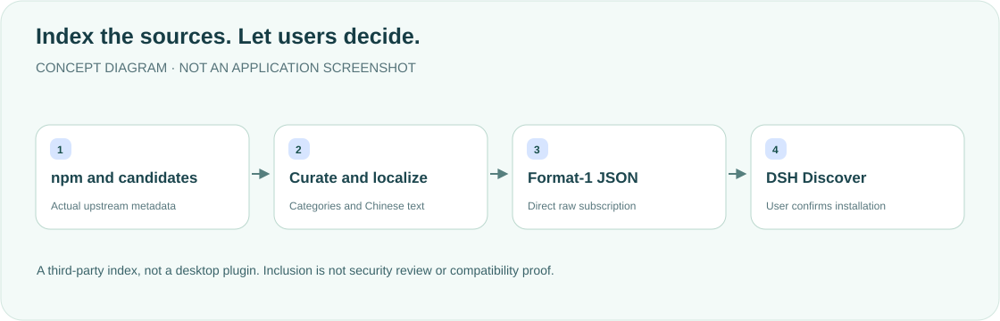

<div align="center">

<h1>DSH Community Market · Chinese index</h1>
<p><strong>A Chinese-language entry point for Plugins → Discover.</strong></p>
<p><a href="README.md">简体中文</a> · <strong>English</strong></p>
<p>format 1 · 597 plugins · 3,904 versions · 14 categories</p>
<p><a href="#features">Features</a> · <a href="#how-it-works">How it works</a> · <a href="#subscribe">Subscribe</a> · <a href="#sources">Sources</a> · <a href="#maintenance-and-validation">Maintenance</a></p>
</div>

---

A **third-party marketplace index, not a desktop plugin**. It aggregates, categorizes and localizes package metadata without hosting plugins, proxying downloads or performing installation. Counts describe the current [`index.json`](index.json) snapshot (1,131,934 bytes), not continuous live scanning. The old README's 9,138 versions/~2.2MB did not match this file and have been corrected.

## Features

<table><tr>
<td width="33%"><strong>🧭 Chinese discovery</strong><br/><br/>Chinese market name, introduction and all14 categories, retaining required English fallbacks.</td>
<td width="33%"><strong>📦 Verifiable metadata</strong><br/><br/>Upstream versions, sources, timestamps, engines, homepages and repositories—not invented install details.</td>
<td width="33%"><strong>🔗 Direct subscription</strong><br/><br/>Add raw.githubusercontent.com JSON to Discover, without loading a separate plugin entry.</td>
</tr><tr>
<td><strong>🏷 Category overrides</strong><br/><br/>Curated repository-level mappings precede name/description keyword rules.</td>
<td><strong>🌏 Incremental localization</strong><br/><br/>Curated/upstream Chinese where available, otherwise original manifest text; not a fully translated catalog.</td>
<td><strong>🛠 Reproducible generation</strong><br/><br/>Scripts retain scan caches/local overrides and explicitly refresh data when requested.</td>
</tr></table>

## How it works



## Subscribe

1. Open DSH **Plugins → Discover → Add index source**.
2. Paste and save the direct URL:

```text
https://raw.githubusercontent.com/yueyexiayu/dsh-market-zh/main/index.json
```

3. Select the market in the left menu. Categories come from `metadata.categories`; review source, permissions and version in each installation confirmation.

Do not substitute a redirecting `github.com/.../raw/...` URL. No desktop patch, plugins-directory copy or source execution is required.

## Sources

| Source | Purpose |
| --- | --- |
| npm registry | Packages declaring `dsh.bundle.patch` and their installable versions |
| [awesome-dsh-plugin](https://github.com/bruc3van/awesome-dsh-plugin) | `data/packages.json` mappings, format-1 selections and candidates |
| [Upstream curated.json](https://github.com/bruc3van/awesome-dsh-plugin/blob/main/data/curated.json) / [`scripts/build.mjs`](scripts/build.mjs) | Categories, Chinese overrides, keyword discovery and index generation |

To fit the Host fetch timeout, the existing script retains at most10 recent versions per plugin, not complete npm history. curated.json is fetched from upstream, not a local file in this repository.

Name, versions, source, engines, publishTimestamp, homepage and repository retain upstream values. Inclusion means metadata could be verified, **not security review or compatibility assurance**. Categories cover development, media/vision, search/web, integration/sharing, sessions/sync, models/providers, agents/workflows, backup/migration, research, interface, memory, utilities, browsers/automation and other.

## Maintenance and validation

<details>
<summary><strong>Regeneration, translation and format checks</strong></summary>

Run from repository root; `.cache/scan.json` is reused when present. This fetches upstream data and rewrites the index—it **was not executed for this documentation update**:

```sh
node scripts/build.mjs
```

For a full refresh, first confirm/back up/remove this repository's scan cache, then rerun. Extend the build script's `ZH` table for translations. LocalizedText objects must retain `en` fallbacks.

This checks JSON/basic fields and prints actual counts, **not the complete official schema**:

```sh
node --input-type=module -e '
import {readFileSync} from "node:fs";
const i=JSON.parse(readFileSync("index.json","utf8"));
if(i.format!==1||!Array.isArray(i.plugins))throw Error("Invalid index shape");
console.log({plugins:i.plugins.length,versions:i.plugins.reduce((n,p)=>n+Object.keys(p.versions).length,0),categories:Object.keys(i.metadata.categories).length});
'
```

Maintainers should additionally use official `parseMarketIndex` in a matching DSH source environment. Parseable JSON is not host installation acceptance.

</details>

This update changes documentation/original artwork only and checks existing JSON counts, bilingual content, links and desktop/mobile layout. No upstream index refresh, plugin installation or DSH restart was performed.

## Scope and license

Each plugin retains its author's copyright/license. This repository currently has no standalone LICENSE; none is added and visibility is unchanged.

<div align="center"><sub>A Chinese entry point. Traceable sources. · <a href="README.md">阅读中文版 →</a></sub></div>
