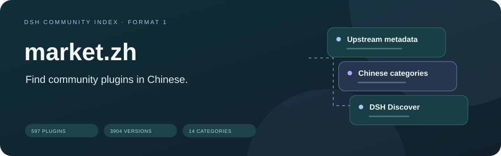
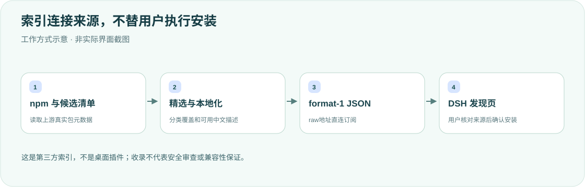

<div align="center">

<h1>DSH 社区市场 · 中文索引</h1>
<p><strong>给「插件 → 发现」一个更容易浏览的中文入口。</strong></p>
<p><strong>简体中文</strong> · <a href="README.en.md">English</a></p>
<p>format 1 · 597 个插件 · 3,904 个版本 · 14 个分类</p>
<p><a href="#核心能力">核心能力</a> · <a href="#工作方式">工作方式</a> · <a href="#使用索引">使用索引</a> · <a href="#数据来源">数据来源</a> · <a href="#维护与验证">维护与验证</a></p>
</div>

---

这是**第三方市场索引，不是桌面插件**。仓库聚合、分类和本地化已有包元数据，不托管插件、不代理下载、不执行安装。统计来自当前[`index.json`](index.json)快照（1,131,934字节），不代表持续实时扫描；旧README中的9,138版本/约2.2MB与现有文件不符，本轮已据实修正。

## 核心能力

<table><tr>
<td width="33%"><strong>🧭 中文浏览入口</strong><br/><br/>中文市场名、介绍及全部14个分类，保留宿主要求的英文回退。</td>
<td width="33%"><strong>📦 可核实包元数据</strong><br/><br/>版本、来源、发布时间、engines、主页与仓库来自上游，不编造安装信息。</td>
<td width="33%"><strong>🔗 直接订阅</strong><br/><br/>以raw.githubusercontent.com直连JSON加入发现页，不加载额外插件入口。</td>
</tr><tr>
<td><strong>🏷 分类覆盖</strong><br/><br/>先用curated仓库级覆盖，再按名称与描述关键词归类。</td>
<td><strong>🌏 渐进本地化</strong><br/><br/>精选和上游中文描述优先，其余保留manifest原文，并非全条目翻译。</td>
<td><strong>🛠 可再生成</strong><br/><br/>构建脚本保留扫描缓存与本地覆盖，维护时明确刷新数据而非伪造更新。</td>
</tr></table>

## 工作方式



## 使用索引

1. 在DSH打开 **插件 → 发现 → 添加索引源**。
2. 粘贴以下直连地址后保存：

```text
https://raw.githubusercontent.com/yueyexiayu/dsh-market-zh/main/index.json
```

3. 用左侧市场菜单切换来源，分类按钮读取 `metadata.categories`，安装前核对确认框中的来源、权限与版本。

不要改用 `github.com/.../raw/...` 的重定向地址。无需修改desktop patch、复制到plugins目录或运行本仓库源码。

## 数据来源

| 来源 | 用途 |
| --- | --- |
| npm registry | 扫描声明 `dsh.bundle.patch` 的包及可安装版本 |
| [awesome-dsh-plugin](https://github.com/bruc3van/awesome-dsh-plugin) | `data/packages.json`映射、format-1精选及候选清单 |
| [上游curated.json](https://github.com/bruc3van/awesome-dsh-plugin/blob/main/data/curated.json) / [`scripts/build.mjs`](scripts/build.mjs) | 分类、中文覆盖、关键词扫描和索引生成 |

现有脚本为适配宿主抓取时限，每个插件只保留最近最多10个版本；索引不是完整npm历史。curated.json来自上游，不是本仓库的本地文件。

名称、版本、来源、engines、publishTimestamp、homepage、repository沿用上游。收录仅表示元数据可核实，**不是安全审查或兼容性保证**。分类包括开发工具、媒体与视觉、搜索与联网、集成与分享、会话与同步、模型与提供方、代理与工作流、备份与迁移、知识与研究、界面与体验、记忆与知识库、实用工具、浏览器与自动化及其他。

## 维护与验证

<details>
<summary><strong>重新生成、翻译与格式验证</strong></summary>

在仓库根目录执行，存在 `.cache/scan.json` 时复用扫描缓存。构建会联网读取上游并写回索引，**不是本轮已经执行的操作**：

```sh
node scripts/build.mjs
```

全量刷新前先确认本仓库缓存位置并备份/移除扫描缓存，再重跑。中文覆盖可在构建脚本的 `ZH` 表补齐；LocalizedText对象必须含 `en`，不能删除英文回退。

以下只检查本地JSON与基本字段、输出实际计数，**不是完整官方schema验证**：

```sh
node --input-type=module -e '
import {readFileSync} from "node:fs";
const i=JSON.parse(readFileSync("index.json","utf8"));
if(i.format!==1||!Array.isArray(i.plugins))throw Error("Invalid index shape");
console.log({plugins:i.plugins.length,versions:i.plugins.reduce((n,p)=>n+Object.keys(p.versions).length,0),categories:Object.keys(i.metadata.categories).length});
'
```

维护者还应在匹配的DSH源码环境使用官方 `parseMarketIndex` 校验，而不把JSON可解析冒充宿主安装验收。

</details>

本轮仅改文档和原创图示，核对既有JSON统计、双语、链接和桌面/手机排版；未刷新上游索引、安装插件或重启DSH。

## 范围与许可

各插件版权和许可证以原作者声明为准。本仓库当前没有独立LICENSE，本轮不新增许可或改变可见性。

<div align="center"><sub>中文入口，明确来源。 · <a href="README.en.md">Read in English →</a></sub></div>
